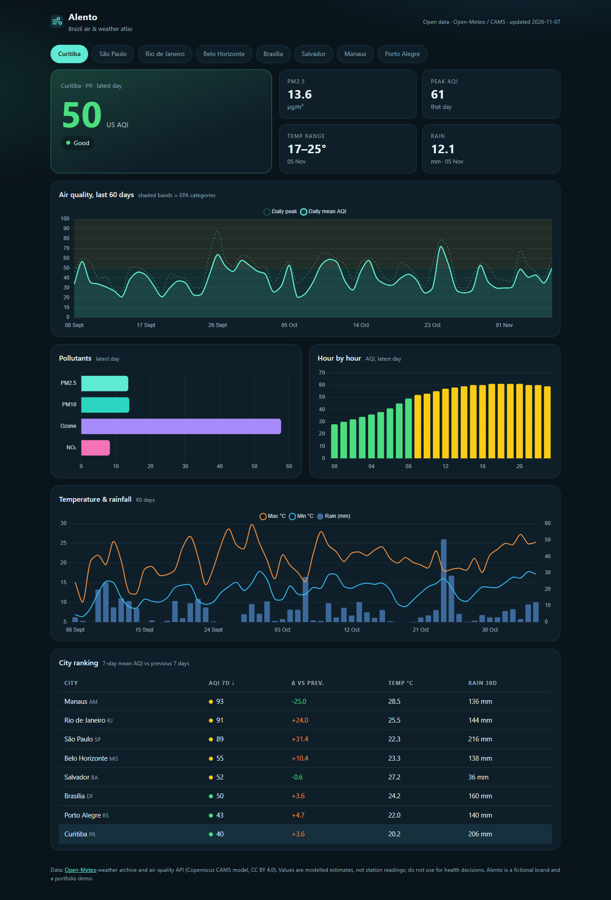
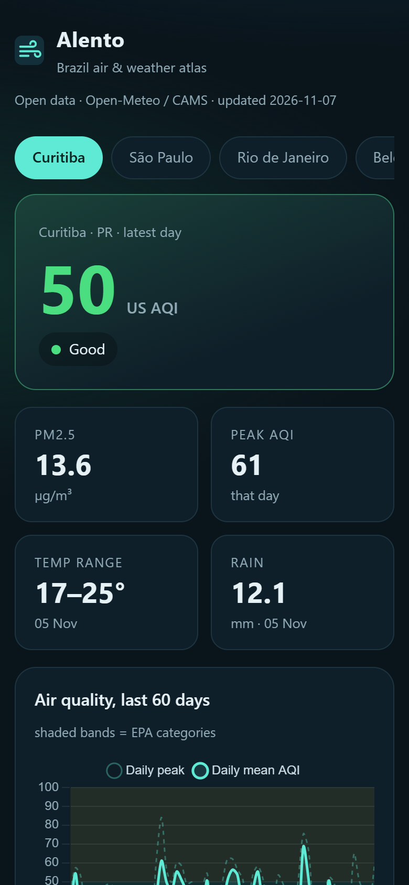

# Alento — Brazil air & weather atlas

[](https://github.com/alissonlittig/alento-ar-dashboard/actions/workflows/ci.yml)

**Live demo:** https://alissonlittig.github.io/alento-ar-dashboard/

An air-quality and weather dashboard for eight Brazilian cities, built on **open public data with no login or API key**. Pick a city and see the latest US AQI, pollutants (PM2.5, PM10, ozone, NO₂), the hourly profile, 60 days of AQI with EPA category bands, temperature and rainfall, plus a sortable ranking of all cities.




## Stack
- **Svelte 5 + Vite**, **Chart.js** (tree-shaken, charts drawn lazily near the viewport)
- **Python ETL** (`etl/fetch.py`, standard library only) → `public/data.json`, a static snapshot served with the site
- Vitest unit tests, GitHub Actions CI (test → build → deploy to GitHub Pages), weekly data-refresh workflow

## Data
[Open-Meteo](https://open-meteo.com/) Historical Weather API and Air Quality API (Copernicus CAMS model, CC BY 4.0). Air-quality values are modelled estimates, not station readings: not for health decisions. "Alento" is a fictional brand; this is a portfolio demo.

## Run locally
```bash
npm install
npm test
npm run etl      # optional: re-download the data (needs curl + Python 3)
npm run dev
```

## Notes
- US AQI categories follow the EPA scale (Good ≤ 50 … Hazardous > 300); the logic lives in `src/lib/aqi.js` and is unit-tested.
- Responsive down to 390 px with no horizontal page scroll; the ranking table scrolls inside its card.
- Lighthouse (mobile, headless, local server): Accessibility 100, Best Practices 100, SEO 100.
